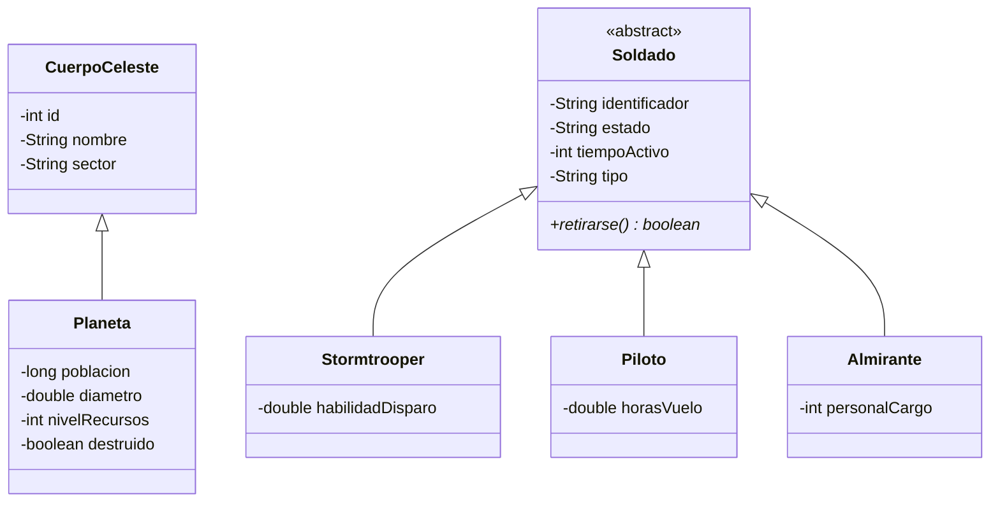
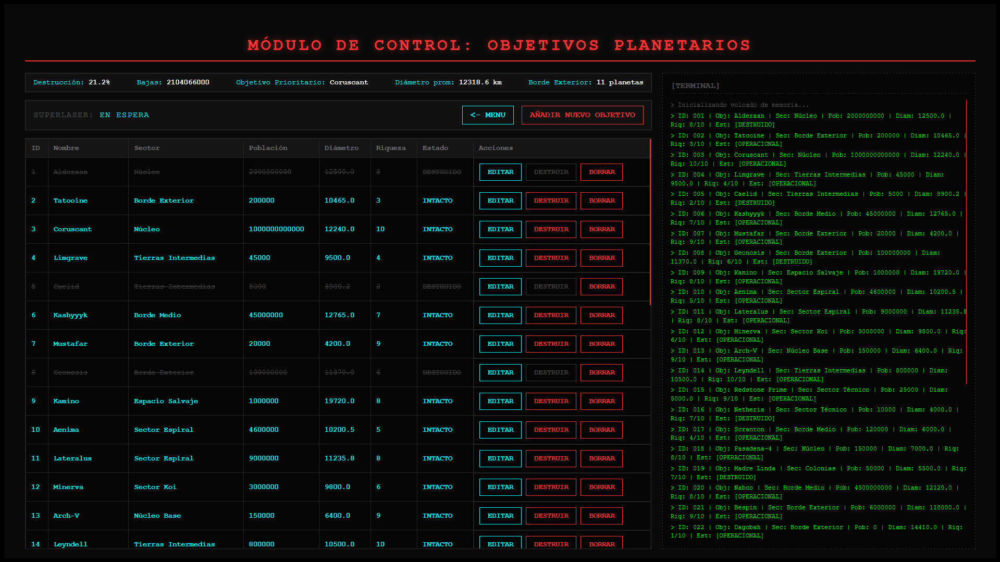
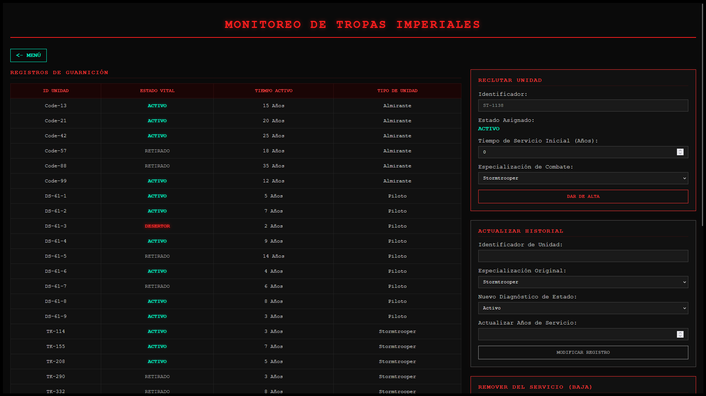

# Death Star Management System

Aplicación web para administrar una Estrella de la Muerte ficticia. Tiene dos módulos: **objetivos planetarios** (registrar, editar, destruir y borrar planetas, con estadísticas de la campaña) y **pelotón imperial** (alta, actualización y baja de Stormtroopers, Pilotos y Almirantes, con reportes sobre las tropas).

Proyecto en equipo para el laboratorio de Programación Orientada a Objetos (Ingeniería en Computación, UAM Azcapotzalco). Hecho con Java, JSP y MariaDB.

 <!-- TODO: agregar captura -->

## Funcionalidades

### Objetivos planetarios (`planetas.jsp`)

- Listado de planetas con su estado (intacto o destruido).
- Alta de planetas con validación de ID repetido, edición y borrado.
- **Destruir** un planeta: lo marca como destruido sin eliminarlo del registro.
- Panel de estadísticas calculadas con consultas SQL agregadas:
  - porcentaje de planetas destruidos
  - bajas totales (suma de la población de los planetas destruidos)
  - objetivo prioritario (planeta intacto con mayor nivel de recursos)
  - diámetro promedio
  - cantidad de planetas en el sector Borde Exterior

### Pelotón imperial (`soldados.jsp`)

- Listado de soldados con su estado (activo, retirado o desertor).
- Alta de unidades (Stormtrooper, Piloto o Almirante), actualización de estado y años de servicio, y baja.
- Reporte calculado en Java por la clase `OficinaImperial`:
  - unidades fuera de servicio (retiradas o desertoras)
  - promedio de subordinados a cargo de los Almirantes
  - promedio de horas de vuelo de los Pilotos
  - Stormtrooper más y menos hábil disparando
  - candidatos a retiro, según los años de servicio de cada tipo de unidad (15 para Stormtrooper, 10 para Piloto, 20 para Almirante)

## Diseño orientado a objetos



| Clase | Responsabilidad |
|---|---|
| `CuerpoCeleste` | Clase base con los datos comunes de un cuerpo celeste (id, nombre, sector). |
| `Planeta` | Hereda de `CuerpoCeleste`; agrega población, diámetro, nivel de recursos y estado de destrucción. Sobrescribe `toString()`. |
| `Soldado` | Clase abstracta con los datos comunes de una unidad. Declara el método abstracto `retirarse()`. |
| `Stormtrooper`, `Piloto`, `Almirante` | Heredan de `Soldado`, agregan su atributo propio e implementan `retirarse()` con su propia regla (polimorfismo). |
| `OficinaImperial` | Operaciones estadísticas sobre una lista de soldados; usa `instanceof` y casting para distinguir cada tipo de unidad. |
| `ControladorBD` | Acceso a MariaDB mediante JDBC: conexión, operaciones de alta, consulta, actualización y baja de planetas y soldados, y consultas agregadas. |

## Arquitectura

```
Navegador  ->  JSP  ->  ControladorBD (JDBC)  ->  MariaDB
                |
                +--> modelo (Planeta, Soldado, ...) y OficinaImperial
```

Los JSP reciben las peticiones, usan `ControladorBD` para leer y escribir en la base de datos, y construyen la página con objetos del paquete `modelo`. No usa Servlets ni frameworks: la lógica de cada acción vive en un JSP.

## Tecnologías

| Capa | Tecnología |
|---|---|
| Lenguaje | Java |
| Vista y control de peticiones | JSP |
| Acceso a datos | JDBC con MySQL Connector/J 8.0.30 (incluido en `lib/`) |
| Base de datos | MariaDB |
| Servidor de aplicaciones | Apache Tomcat 11 (Jakarta EE 11) |
| Estilos | CSS |
| IDE | NetBeans (proyecto Ant) |

## Requisitos

- JDK 25. El proyecto está configurado con `javac.source=25` en `nbproject/project.properties`. Si usas otra versión, ajusta `javac.source` y `javac.target`. El código usa `System.getLogger`, así que necesita JDK 9 o superior.
- Apache Tomcat 11
- MariaDB
- NetBeans (opcional)

## Instalación y ejecución

1. **Clona el repositorio**

   ```bash
   git clone https://github.com/Emmanems567/DeathStarManager.git
   cd DeathStarManager
   ```

2. **Crea la base de datos con datos de ejemplo**

   ```bash
   mysql -u TU_USUARIO -p < script/base.sql
   ```

   El script crea la base `deathStar` con las tablas `planetas` y `soldados` y las llena con datos ficticios.

3. **Configura la conexión**

   En `src/java/datos/ControladorBD.java` ajusta las constantes `USER` y `PSWD` con tu usuario y contraseña de MariaDB. El proyecto espera la base `deathStar` en `localhost:3306`.

4. **Ejecuta la aplicación**

   - **Con NetBeans:** abre el proyecto, configura Tomcat 11 como servidor y presiona *Run*.
   - **Con Tomcat directamente:** genera el WAR con *Clean and Build* (queda en `dist/DeathStar.war`), cópialo a la carpeta `webapps/` de Tomcat e inicia el servidor.

5. **Abre en el navegador**

   ```
   http://localhost:8080/DeathStar/
   ```

## Estructura del proyecto

```
DeathStar/
├── script/
│   └── base.sql                  # esquema y datos de ejemplo
├── lib/
│   └── mysql-connector-java-8.0.30.jar
├── src/java/
│   ├── modelo/                   # CuerpoCeleste, Planeta, Soldado, Stormtrooper,
│   │                             # Piloto, Almirante, OficinaImperial
│   └── datos/
│       └── ControladorBD.java    # acceso a la base de datos
├── web/
│   ├── index.html                # menú principal
│   ├── planetas.jsp              # módulo de planetas
│   ├── soldados.jsp              # módulo de soldados
│   ├── *Planeta.jsp, *Soldado.jsp, formulario*Planeta.jsp   # acciones y formularios
│   ├── css/estilos.css
│   └── img/
├── nbproject/, build.xml         # configuración de NetBeans
```

## Capturas de pantalla

| Planetas | Pelotón imperial |
|---|---|
|  |  |

## Notas

Proyecto con fines académicos y sin fines de lucro. Star Wars y sus elementos son propiedad de Lucasfilm y Disney; los datos de la aplicación son ficticios.

## Equipo y contribuciones

Proyecto desarrollado en equipo por dos personas. Cada integrante se encargó de un módulo, y el diseño visual lo hizo uno de ellos para toda la aplicación:

| Integrante | Contribución |
|---|---|
| **Emmanuel Alejandro Adame López** ([GitHub](https://github.com/Emmanems567)) | **Módulo de planetas:** clases `CuerpoCeleste` y `Planeta`, los métodos de planetas de `ControladorBD` (alta, consulta, edición, destrucción, borrado y consultas estadísticas) y las páginas JSP de planetas. **Diseño visual:** hoja de estilos `estilos.css`, menú principal y estética de terminal, que se reutilizan en toda la aplicación. |
| Hector Daniel Rodriguez Tornell | **Módulo de pelotón imperial:** jerarquía `Soldado` (`Stormtrooper`, `Piloto`, `Almirante`), clase `OficinaImperial`, los métodos de soldados de `ControladorBD` y las páginas JSP de soldados. |

La clase `ControladorBD` es compartida: contiene los métodos de ambos módulos.
